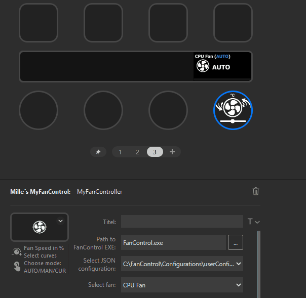

# FanControl Encoder for Stream Deck

A Stream Deck plugin for [FanControl](https://getfancontrol.com/):

* **Dial (Stream Deck+):** switch modes, adjust fan speeds and select fan curves directly with the dials (encoders), interacting directly with FanControl's JSON configuration.
* **Display keys (any Stream Deck):** show live temperatures, fan output (%) and fan speed (RPM) on regular keys.



### Why is this not on the Elgato Marketplace?
Due to recent changes in the Elgato Maker Agreement, developers are now required to accept comprehensive personal liability and indemnification clauses under Californian law. As an independent developer offering free, open-source hobby projects, I cannot accept these legal and financial risks.

Therefore, this plugin—and all future updates to my existing plugins—will exclusively be published here on GitHub. You can always find the latest, safe-to-use `.streamDeckPlugin` files directly on the Releases page.

## Features

* **Control Modes:** Switch between `Auto`, `Manual` (Fixed %), and `Curve` (Software Control) by pushing the dial.
* **Precision Control:**
    * **Manual Mode:** Rotate to adjust fan speed (0-100%).
    * **Curve Mode:** Rotate to cycle through available fan curves defined in FanControl.
* **Live Feedback:** Shows current fan name, mode, value/curve, and error states on the touch strip.
* **Live Display Keys (new in v1.1):** Show a temperature (°C/°F), a fan's output (%) or its speed (RPM) on a regular key, with configurable color levels. No extra setup needed.
* **Seamless Profile Switching (UAC Bypass):** Optional feature to switch FanControl configurations instantly and silently using Windows Task Scheduler, preventing "ghost" icons in the tray.

## Prerequisites

* Windows 10 or 11
* An Elgato Stream Deck:
    * **Display keys** (Temperature, Fan Speed, Fan RPM): any model with keys (Stream Deck, MK.2, XL, Mini, Neo, Stream Deck+, Mobile).
    * **FanControl Dial**: Stream Deck+ (dials) only.
* [FanControl](https://getfancontrol.com/) (by Rem0o) installed and configured.
    * **Recommendation:** Use the **portable version** of FanControl.
    * **Important:** Place the folder in a simple location like `C:\FanControl` or `D:\Tools\FanControl`. **Avoid** placing it in `C:\Program Files` or `C:\Program Files (x86)`, as strict Windows permissions there can prevent the plugin or helper scripts from working correctly.

## Installation

1.  Download the latest `.streamDeckPlugin` release.
2.  Double-click the file to install it to your Stream Deck software.
3.  **Display keys:** drag *Temperature Display*, *Fan Speed Display* or *Fan RPM Display* onto any key and select the sensor. No further setup is needed.
4.  **Dial (Stream Deck+):** drag the **FanControl Dial** action to a dial stack and follow the configuration below.

## Configuration (Dial)

The settings below (EXE path, JSON configuration, UAC bypass) are only needed for the dial. The display keys find FanControl on their own.

### Basic Setup
1.  **Path to FanControl EXE:** Select your `FanControl.exe`.
2.  **Select JSON Configuration:** Choose your configuration file (usually `userConfig.json` inside the `Configurations` folder).
3.  **Select Fan:** Choose the fan or control sensor you want to control with this dial.

### ⚠️ Important: Setting up the UAC Bypass (Silent Restart)

**Why is this necessary?**
Every time you change a value (Speed, Mode, Curve) via the Stream Deck, the plugin updates the configuration file and **must restart FanControl** to apply the changes immediately.
Without this bypass, Windows User Account Control (UAC) will trigger a popup ("Do you want to allow this app to make changes?") **every single time** you touch the dial.

To enable a seamless, silent restart in the background, we use a **two-script method** to handle Windows permissions correctly (User vs. Admin).

**If you enable "Bypass UAC prompt" in the plugin settings without these steps, the plugin will show an ERROR.**

#### Step 1: Create the Helper Scripts
We need two scripts in your FanControl folder. One for the Stream Deck (User trigger) and one for the Task Scheduler (Admin worker).

1.  Go to the folder where your `FanControl.exe` is located (e.g., `C:\FanControl`).

2.  **Create Script A (`silent_restart.vbs`):**
    * Create a new text file, paste the code below, and save it as **`silent_restart.vbs`**.
    ```vbscript
    Set WshShell = CreateObject("WScript.Shell")
    ' Trigger the Task Scheduler to do the heavy lifting
    WshShell.Run "schtasks /run /tn ""FanControlRestart""", 0, False
    ```

3.  **Create Script B (`admin_action.vbs`):**
    * Create another text file, paste the code below, and save it as **`admin_action.vbs`**.
    * *Note: This script now reads the requested configuration from a temporary file (`active_config.txt`) created by the plugin and switches the profile instantly without killing the app.*

    ```vbscript
    Set WshShell = CreateObject("WScript.Shell")
    Set fso = CreateObject("Scripting.FileSystemObject")

    ' Determine path to config text file (located in the same folder as this script)
    strPath = WScript.ScriptFullName
    strFolder = fso.GetParentFolderName(strPath)
    strConfigFile = fso.BuildPath(strFolder, "active_config.txt")

    ' Default config if file is not readable (Fallback)
    configName = "userConfig.json"

    ' Try to read the active config filename from the text file
    If fso.FileExists(strConfigFile) Then
        Set objFile = fso.OpenTextFile(strConfigFile, 1)
        If Not objFile.AtEndOfStream Then
            configName = objFile.ReadLine
        End If
        objFile.Close
    End If

    WshShell.Run "FanControl.exe -m -c " & Chr(34) & configName & Chr(34), 0, False
    ```

#### Step 2: Create the Windows Task
1.  Open **Task Scheduler** (`taskschd.msc`).
2.  Click **Create Task...** (on the right).
3.  **General Tab:**
    * Name: `FanControlRestart` (Exact spelling is important!).
    * **Check "Run with highest privileges"** (Crucial! Without this, FanControl won't close).
    * Select **Run only when user is logged on**.
4.  **Actions Tab:**
    * Click **New...** -> **Start a program**.
    * **Program/script:** `wscript.exe`
    * **Add arguments:** `"C:\Path\To\Your\FanControl\admin_action.vbs"`
        *(⚠️ Important: Use quotes around the path! Adjust the path to your folder!)*
    * **Start in:** `C:\Path\To\Your\FanControl\`
        *(⚠️ Important: NO quotes here! This ensures FanControl finds the JSON config.)*
5.  **Conditions Tab:**
    * **Uncheck** "Start the task only if the computer is on AC power" (Important for laptops).
6.  **Settings Tab:**
    * Check **Allow task to be run on demand**.
    * If the task is already running: **Stop the existing instance**.
7.  Click **OK**.

#### Step 3: Enable in Plugin
* In the Stream Deck software, check the box **"Use silent restart (Task Scheduler)"**.
* If everything is correct, the error message on the dial will disappear.

## Usage

* **Push Dial:** Enters "Selection Mode" (Title turns blue).
    * Rotate to choose: `AUTO`, `MAN` (Manual), or `CURVE`.
    * Push again to confirm and apply.
* **Rotate Dial (Normal Mode):**
    * **Manual:** Increases/Decreases fan speed %.
    * **Curve:** Cycles through the list of curves defined in your JSON.
    * **Auto:** **No action.** In Auto mode, the fan is controlled entirely by FanControl logic. Manual adjustments are disabled to prevent conflicts.

## Temperature & Fan Display Keys

Three key actions show live values directly from FanControl:

* **Temperature Display:** any temperature sensor known to FanControl (hardware or custom) in °C or °F. Pressing the key toggles the unit.
* **Fan Speed Display:** the current output (%) of a fan control.
* **Fan RPM Display:** the current speed (RPM) of a fan sensor.

No extra FanControl plugin and no setup are required. The values are read through FanControl's own local interface
(the named pipe FanControl uses between its app and its service), so FanControl just has to be running, either as app or as service.
Sensor names are taken from the nicknames in your active FanControl configuration.

> This interface is internal to FanControl and not officially documented. It was verified against FanControl V286; a future FanControl update could change it. The dial action is not affected by this.

### Color levels
Each key has three color levels: *Normal*, *Level 2 from* and *Level 3 from*. Thresholds use the displayed unit (°C/°F, % or RPM); leave a field empty to disable that level.
When the temperature unit is switched, the thresholds are converted automatically. Colors can be applied to the value and bar or to the whole key background.

### Key states
| Display | Meaning |
| --- | --- |
| `OFFLINE` | FanControl is not running |
| `WAIT` | FanControl is running but has not initialized its sensors yet |
| `NOT FOUND` | The selected sensor does not exist (anymore) |
| `--` | FanControl currently reports no value for this sensor |

## Troubleshooting

* **Red "ERROR" Screen:**
    * **"Missing Task":** The task `FanControlRestart` does not exist in Windows Task Scheduler.
    * **"Missing VBS":** One of the helper scripts (`silent_restart.vbs` or `admin_action.vbs`) was not found in the same folder as `FanControl.exe`.
* **FanControl does not close/restart (Icon stays in tray):**
    * This usually means the Task Scheduler doesn't have permission to kill the process.
    * Check Step 2: Did you enable **"Run with highest privileges"**?
    * Check Step 2: Did you point the Action to `admin_action.vbs`?
* **FanControl restarts but old values remain:**
    * Wait time might be too short. Try increasing `WScript.Sleep 500` to `2000` in `admin_action.vbs`.
* **Checking whether the plugin shut down cleanly:**
    * Since v1.0.6 the plugin writes start and shutdown events with its process ID to `logs\lifecycle.log` inside the plugin folder (`%APPDATA%\Elgato\StreamDeck\Plugins\com.holgermilz.myfancontrol.sdPlugin`).
    * A clean session ends with `Shutdown: ...`, `Cleanup done` and `exit, code 0`. If the last line is `Start ...` or `exit ... without orderly shutdown!`, the plugin did not shut down cleanly.

## ⚠️ DISCLAIMER & WARNING

**USE AT YOUR OWN RISK.**

* **Risk of Overheating:** Manually turning off fans (0%) or setting insufficient fan speeds can lead to severe **hardware overheating** and permanent damage to your components.
* **No Warranty:** This plugin is **not** affiliated with Elgato, Corsair, or the developer of FanControl (Rem0o). The author of this plugin accepts **no liability** for any software issues, hardware damage, or data loss resulting from the use of this tool.
* **Responsibility:** Always monitor your system temperatures when manually controlling fan curves. Ensure that critical cooling systems (CPU/GPU) have fail-safes enabled in your BIOS.
License

## License

[MIT License](LICENSE)
